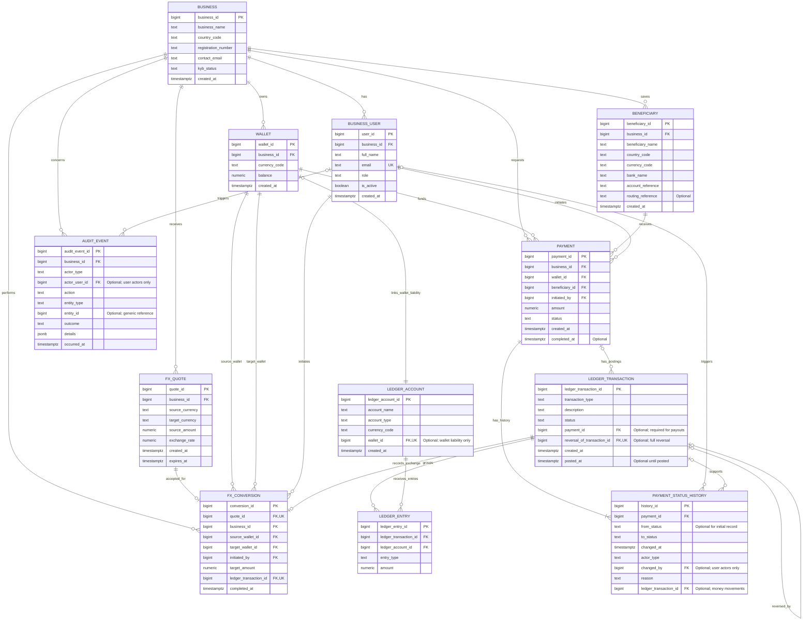

# Corridor Pay — ER Diagram

Working draft of the 12 proposed tables. Implementation and testing are still pending.

Uppercase diagram labels correspond to the lowercase SQL table names in the design document.

## Reading the diagram

- PK means primary key.
- FK means foreign key.
- UK means unique key.
- || means exactly one.
- |o or o| means zero or one.
- o{ means zero or many.
- |{ means one or many.
- The symbol beside an entity describes how many of that entity may relate to one record at the other end.
- Each wallet has exactly one liability ledger account. Each ledger account has zero or one wallet because platform accounts are not business wallets.
- Each conversion has exactly one ledger transaction. A ledger transaction has zero or one conversion because other transaction types record funding or payouts.
- Each original ledger transaction can have zero or one full reversal. A reversal must reference one original transaction; other transactions have no original reference.
- User references in history and audit events are empty for system-triggered actions.

## Additional constraints

The diagram shows relationships and keys. The following rules require SQL constraints or controlled routines.

### Business ownership and wallets

- Supported countries are NG, CA, GB and US.
- Supported currencies are NGN, CAD, GBP and USD.
- UNIQUE(business_id, currency_code) on wallet ensures one wallet per currency per business.
- UNIQUE(country_code, registration_number) on business prevents duplicate registration references within a country.
- Business-user email addresses are unique and compared case-insensitively.
- Payment wallets, beneficiaries and initiating users must belong to the payment's business.
- Conversion quotes, wallets and initiating users must belong to the conversion's business.
- Composite foreign keys and controlled routines will enforce ownership.
- Only approved businesses and active admin or finance users may initiate payments or conversions.
- Wallets start at zero and cannot have negative balances.
- Each wallet balance must equal posted credits minus posted debits on its liability account.
- Each wallet-linked ledger account must be a liability account in the wallet's currency.
- A wallet-linked account's wallet association cannot change.
- Platform ledger accounts have no wallet_id.
- Beneficiary records referenced by payments cannot be edited or deleted.

### FX conversions

- Source and target currencies must differ.
- Source and target wallets must match the quote's currencies.
- Quote financial terms cannot change after issue.
- A quote must be accepted before expiry and can produce only one successful conversion.
- Monetary amounts use NUMERIC(20,2), and exchange rates use NUMERIC(24,12).
- Amounts and rates must be positive.
- The target amount is calculated from the source amount and rate, rounded to two decimal places, and must remain positive.
- Each successful conversion links to a posted ledger transaction of type fx_conversion.
- The conversion record, wallet updates and ledger postings are saved in one database transaction.

### Ledger posting

- Draft ledger transactions may have zero or more entries.
- Posted ledger transactions require at least two entries.
- Total debits must equal total credits within every currency represented.
- Posted ledger transactions and their entries cannot be edited or deleted.
- Full reversals swap the original debit and credit entries.
- A reversal must reference a posted original transaction and cannot reference itself.
- Each original transaction can have only one full reversal.
- Ledger accounts referenced by entries cannot be deleted.
- An account's currency and accounting type cannot change after it has posted entries.
- Wallet updates and ledger posting must occur atomically through controlled routines.

### Payouts and status history

- A pending payment does not reserve or deduct funds.
- Each payment receives an initial pending status-history record.
- Payment status changes and history records are saved together.
- Money-moving transitions include their ledger postings in the same database transaction.
- payment_id is required for payout-related ledger transactions, including payout reversals.
- Duplicate payout processing and settlement postings must be prevented.
- Permitted transitions are pending to processing or failed; processing to completed or failed; failed to reversed after deducted funds are returned; completed to reversed after settled funds are returned.
- Other transitions are rejected.
- A payment that fails without a deduction remains failed.
- Reversing a completed payout requires two compensating ledger transactions.
- The history record links to the wallet-restoring transaction; both reversal transactions link to the same payment.
- Failure and reversal history records require a reason.
- The payment's amount, business, wallet and beneficiary cannot change after creation.
- Retrying a failed payment creates a new payment record.
- completed_at retains the original settlement time if a completed payment is later reversed.
- Payment status history is append-only through ordinary application access.

### Audit events and consistency

- Audit events are append-only through ordinary application access.
- User actors must belong to the business recorded in the event or payment.
- changed_by and actor_user_id are required for user-triggered events and empty for system-triggered events.
- Audit entity_id is a generic reference rather than a foreign key to multiple tables.
- Audit details exclude passwords, credentials and full bank account details.
- Successful changes and their audit events are saved together.
- Failed attempts are audited separately after rollback.
- Locks, restricted privileges and controlled routines will protect financial operations.
- Reconciliation will compare stored wallet balances with posted ledger totals.

## Scope and remaining work

This diagram represents an internal database prototype. External banking, external FX settlement, working authentication, fees, overdrafts and partial reversals are outside scope.

Formal normalisation analysis, PostgreSQL implementation and testing remain separate portfolio tasks.