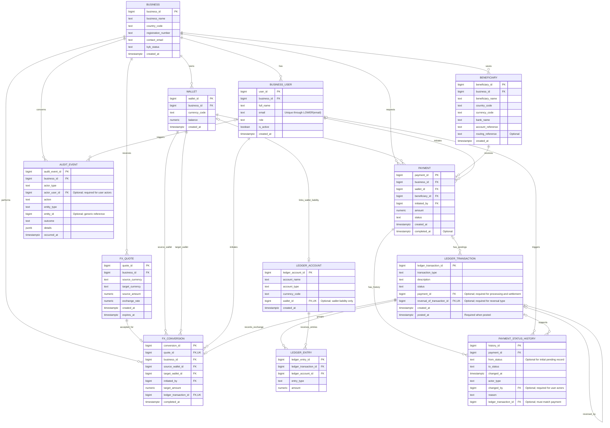

# Corridor Pay — ER Diagram

All 12 tables have been created and their structural constraints tested in `corridorpay_p1_check`. This diagram shows the relationships permitted by the current schema. Some intended business rules still require routines, triggers or access controls.

Uppercase diagram labels correspond to the lowercase SQL table names. See Section 9 of the design document for implementation status.

## Reading the diagram

- PK means primary key.
- FK means foreign key.
- UK marks a column with a uniqueness constraint. Nullable unique references are not candidate keys for the whole table.
- `||` means exactly one.
- `|o` or `o|` means zero or one.
- `o{` means zero or many.
- The symbol beside an entity describes how many of that entity may relate to one record at the other end.
- Each conversion references two wallets: a source wallet and a target wallet.
- Each conversion has exactly one ledger transaction. A ledger transaction has zero or one conversion.
- Each payment may have zero or many ledger transactions. A pending payment does not need a posting.
- Each original ledger transaction may have zero or one full reversal. Transactions of type `reversal` must reference an original transaction.
- User references in history and audit events are empty for system actions.

### Current schema and intended minimums

The schema currently permits a wallet to have zero or one linked ledger account. The intended requirement is exactly one matching liability account, created atomically with the wallet. Platform accounts have no wallet.

The schema currently permits a payment to have zero or more history records. Automatic creation of its initial pending record remains to be implemented.

Ledger transactions currently permit zero or more entries. Posting routines must eventually require at least two entries and equal debit and credit totals within each currency.

## Keys and constraints enforced by the schema

### Businesses, users and wallets

- Supported countries are NG, CA, GB and US.
- Supported currencies are NGN, CAD, GBP and USD.
- `UNIQUE(country_code, registration_number)` prevents duplicate business registration references within a country.
- A unique index on `LOWER(email)` prevents duplicate user emails regardless of letter case.
- Business-user roles are limited to admin, finance and viewer.
- `UNIQUE(business_id, currency_code)` allows one wallet per currency per business.
- Wallet balances default to zero and have a non-negative check.
- Composite foreign keys enforce payment ownership of the wallet, beneficiary and initiating user.
- Composite foreign keys enforce conversion ownership of the quote, both wallets and initiating user.

### Beneficiaries and FX quotes

- Beneficiaries must reference an existing business and use supported country and currency codes.
- Account references are stored as text, preserving letters and leading zeros.
- Routing references are optional.
- Separate businesses may save the same supplier destination.
- Quote source and target currencies must differ.
- Quote amounts and exchange rates must be positive and cannot be numeric NaN values.
- The calculated quote target amount must remain positive after rounding to two decimal places.
- Quote expiry must be later than creation.
- Conversion quote references are unique, preventing two conversion records for one quote.
- Conversion source and target wallet IDs must differ.
- Conversion target amounts must be positive and cannot be numeric NaN values.
- Each conversion references a ledger transaction that cannot be shared by another conversion.

### Payments and ledger records

- Payment amounts must be positive and cannot be numeric NaN values.
- Payment status is limited to pending, processing, completed, failed or reversed.
- A completed payment requires `completed_at`.
- A populated completion timestamp cannot be earlier than payment creation.
- A wallet can link to at most one ledger account.
- A wallet-linked ledger account must be a liability.
- Ledger account types and currencies are restricted to the supported values.
- Ledger entries must reference existing accounts and transactions.
- Entry types are debit or credit, with positive amounts excluding numeric NaN values.
- Ledger transactions have draft or posted status.
- Draft transactions have no posting timestamp; posted transactions require one that is not earlier than creation.
- Payout processing and settlement transactions require a payment reference.
- Funding and FX transactions have no payment reference.
- Reversal transactions require an original-transaction reference; other transaction types cannot have one.
- A transaction cannot reverse itself.
- Each original transaction can be referenced by at most one full reversal.

### History and audit records

- History records reference an existing payment.
- A linked history ledger transaction must belong to that same payment.
- A null `from_status` is permitted only when `to_status` is pending.
- A populated `from_status` cannot equal `to_status`.
- History reasons are required and cannot be blank.
- User actors require a user reference; system actors must have no user reference.
- Audit user actors must belong to the event's business.
- Audit outcomes are success or failure.
- Audit details must be a JSON object and default to `{}`.
- Audit action and entity type cannot be blank.
- Generic audit `entity_id` has no foreign key because it can refer to different tables.

Composite uniqueness constraints used to support ownership foreign keys are defined in `schema.sql`. They are not displayed as individual-column unique keys in this diagram.

## Rules requiring additional enforcement

The following remain intended requirements. Their routines, triggers or access controls have not yet been implemented.

### Access and ownership protection

- Only approved businesses and active admin or finance users may initiate payments or conversions.
- Viewers have read-only access.
- Restricted database privileges and row-level security must be addressed during access-control work.
- History user actors must belong to the payment's business.
- Used beneficiary destinations cannot be edited or deleted.
- Payment amount, business, wallet, beneficiary and initiating user remain fixed after creation.

### Wallets and conversions

- Each wallet is created with one liability ledger account in the same currency.
- Wallet ownership, currency and its ledger-account association are protected against changes that would invalidate financial history.
- Wallets begin at zero; funding is recorded through the ledger.
- Stored balances change only through controlled posting routines.
- Stored balances reconcile to posted credits minus posted debits on the wallet liability account.
- Payment wallet and beneficiary currencies must match.
- Conversion wallets must match the quote's source and target currencies.
- Quote terms remain fixed after issue.
- Quote expiry is checked at execution after acquiring the relevant locks.
- Conversion target amounts must equal the rounded quote calculation.
- Successful conversions require a posted ledger transaction of type `fx_conversion`.
- Conversion records, ledger postings and wallet updates commit atomically.

### Ledger posting and reversals

- Posting requires at least two entries and balanced debits and credits within each currency.
- Posted transactions and their entries cannot be edited or deleted.
- Entries can change only while their transaction is draft.
- Account currency and accounting type cannot change after posted entries exist.
- A wallet-linked account's wallet association cannot change.
- Full reversals reference posted originals and swap their debit and credit entries.
- Payout reversals retain the original payment relationship.
- Duplicate payout processing and settlement postings are prevented.
- Sufficient funds are checked under lock before processing money movements.

### Payout status and auditing

- Each payment receives its initial pending history record automatically.
- Only the transitions defined in the design document are permitted.
- Status changes, history records and associated ledger postings commit together.
- History `from_status` must match the locked current payment status.
- History references a posted ledger transaction when the transition moves money.
- A payment failing before deduction remains failed.
- A deducted payment is marked reversed only after its refund posting succeeds.
- Reversing a completed payout requires two compensating ledger transactions committed together.
- The history row links to the wallet-restoring transaction; both reversal transactions link to the payment.
- `completed_at` retains the original settlement time after reversal.
- Retrying a failed payment creates a new payment record.
- History and audit records are append-only through ordinary application access.
- Audit details exclude passwords, credentials and full bank account details.
- Successful changes and audit events commit together.
- Failed attempts are audited separately after rollback.

## Scope and implementation evidence

This is an internal database prototype. External banking, external FX settlement, working authentication, fees, overdrafts and partial reversals are outside scope.

The full schema was built successfully in `corridorpay_p1_check`. The 35 numbered structural tests produced their reviewed expected outcomes, including 25 intentional constraint errors. The final rollback left all 12 tables empty.

The SQL scripts, execution transcripts and selected screenshots are stored in this portfolio folder. The normalisation analysis is maintained separately. These structural tests do not demonstrate operational money movements, ledger-controlled wallet updates or concurrency control.