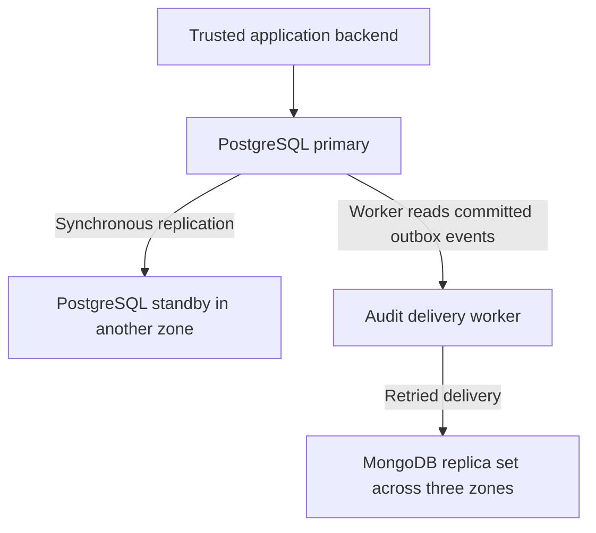

# Portfolio 5 — Distributed and Cloud Database Exercise

## Purpose and scope

This portfolio discusses a proposed distributed deployment for
Corridor Pay, using the PostgreSQL financial database and MongoDB
audit model developed in the earlier portfolios.

It covers replication, sharding, availability, consistency and
cloud deployment trade-offs.

Read-only checks document the current local environment.
The proposed cloud architecture has not been deployed.
Replication, failover, sharding and disaster recovery have not
been practically tested.

## Current deployment evidence

The inspection found:

| Check | Captured result | Interpretation |
| :--- | :--- | :--- |
| PostgreSQL container | corridor-pg, postgres:16, running | Local PostgreSQL service |
| PostgreSQL storage | Volume at /var/lib/postgresql/data | Data stored outside the container's writable layer |
| PostgreSQL recovery state | is_standby = false | The inspected server was not operating as a standby |
| PostgreSQL replication connections | 0 | No replicas were connected at inspection time |
| MongoDB container | corridor-mongo, mongo:7, running | Local MongoDB service |
| MongoDB storage | Volumes at /data/configdb and /data/db | Persistent container storage |
| MongoDB replica set | null | No replica-set name was reported |
| MongoDB replica-set hosts | Empty array | No replica-set members were reported |
| MongoDB writable status | true | The standalone server accepted writes |

PostgreSQL's connection count is a point-in-time observation.
It does not establish whether an offline replica was previously
configured.

MongoDB reporting writable_primary as true does not, by itself,
prove replication. The absent replica-set name distinguishes
this deployment from a replica set.

Both databases run through Docker Desktop on the same Mac.
They share a host failure risk. Persistent volumes are not
independent backups or evidence of high availability.

## Proposed architecture

The financial ledger would remain authoritative in PostgreSQL.
MongoDB would support audit-event retrieval and analysis.



All components in this diagram are proposed.

The outbox and delivery worker are not implemented in the
current repository. Portfolio 4 contains standalone sample
events rather than synchronized PostgreSQL records.

## Replication

### PostgreSQL financial records

Replication maintains another copy of the financial database.

The proposal uses a primary and a synchronous standby in
separate availability zones. Transaction acknowledgement would
wait for the configured standby durability acknowledgement.

This reduces the risk of losing acknowledged transactions when
the primary fails, within the selected replication guarantees.

The trade-off is extra commit latency and reduced write
availability if the required standby cannot acknowledge.
Asynchronous replication avoids that wait but permits a window
in which a promoted standby may lack recent committed changes.

A failover controller or managed service must coordinate promotion
and prevent the old primary from accepting conflicting writes.
PostgreSQL replication alone does not provide that complete
failure-management system.

Financial writes and spending checks would use the current primary.
Reporting replicas must not authorize spending from stale balances.

### MongoDB audit events

The proposal uses a three-member, data-bearing replica set
distributed across three availability zones.

The primary accepts writes and secondaries replicate changes.
An eligible secondary can become primary after an election.

With three voting members, two members form a majority.
Losing one member can leave a majority available, although an
election may temporarily interrupt writes.

This is a proposed failure tolerance, not a measured availability
result from the local standalone MongoDB container.

## Consistency and duplicate operations

### Financial operations

Corridor Pay must not approve two deductions using the same funds.

Portfolio 3 demonstrated wallet locking and a balance recheck
under READ COMMITTED isolation. Those controls would still be
required on the PostgreSQL primary after adding replication.

Replication does not replace transaction boundaries, business
constraints or duplicate-processing protections.

After a connection failure, a caller may not know whether a
transaction committed. It should check the operation's stable
identifier and recorded outcome before retrying.

A production request-level idempotency mechanism would need
additional implementation. Existing duplicate-posting checks
are not a complete network retry protocol.

### Audit delivery

A proposed transactional outbox would save an event in PostgreSQL
in the same transaction as the financial operation.

A worker would deliver committed events to MongoDB and mark
delivery progress afterwards. If MongoDB were unavailable,
events would remain queued for retry.

A crash after delivery but before recording progress can cause
redelivery. Stable event identifiers and duplicate handling would
make repeated delivery safe. A conflicting payload under the
same identifier should be investigated rather than silently accepted.

This gives eventual consistency between the financial database
and the audit read model. An audit view may temporarily lag behind
a committed payment.

It does not create an atomic transaction across both databases.

### MongoDB read and write choices

The proposal uses majority write concern for audit delivery and
majority read concern for views requiring majority-committed data.

Majority read concern does not guarantee the newest possible
value or make every read linearizable. Read preference, sessions
and the application's consistency requirements must also be
considered.

During a partition without a usable majority, the service should
report that majority-confirmed writes cannot complete rather than
claim successful delivery.

## Sharding

Replication copies data. Sharding distributes different portions
of a dataset across servers.

The current six-document audit dataset does not justify sharding.
The initial proposal therefore uses an unsharded MongoDB replica set.

If audit volume later exceeds a suitably sized replica set,
sharding could distribute storage and write load.

A candidate business-based shard key would support common
business-specific queries. However:

- A very large business could create an uneven workload.
- A timestamp-only range key could concentrate new writes.
- Queries without the shard key may contact multiple shards.
- More servers increase cost and operational complexity.

The existing unique event_id index also constrains the design.
It cannot simply be retained unchanged with an unrelated
business-based shard key. MongoDB's sharded unique-index rules
require compatible shard-key prefixes; hashed indexes cannot
themselves enforce uniqueness.

Shard-key selection and event-identifier uniqueness would need
to be designed and tested together before migration.

The PostgreSQL ledger would initially remain unsharded.
Splitting its related financial records across database servers
would complicate transaction coordination and reconciliation.

## Availability and recovery

| Failure | Proposed response | Main trade-off |
| :--- | :--- | :--- |
| PostgreSQL primary fails | Fence the old primary and promote an eligible standby | Interruption during detection and failover |
| Required synchronous standby becomes unavailable | Restore replication or follow an explicit degraded-mode policy | Write availability versus durability |
| MongoDB member fails | Remaining majority maintains or elects a primary | Temporary election interruption |
| MongoDB is unavailable | Retain committed outbox events and retry delivery | Audit views become delayed |
| Application loses a commit response | Check recorded operation state before retrying | Additional reconciliation logic |
| Accidental deletion or corruption | Restore from independently retained backups | Recovery time and possible data loss |

Replication is not a substitute for backups: unwanted changes
can also replicate.

The proposal includes PostgreSQL base backups and archived WAL
for point-in-time recovery, plus supported MongoDB backups.
Backup access and retention would be separated from ordinary
application permissions.

Restore drills must establish:

- Recovery point objective: acceptable data loss.
- Recovery time objective: acceptable recovery duration.

No recovery objectives or uptime guarantees have been measured
in this portfolio.

## Proposed cloud deployment

A suitable starting architecture would use:

- Managed PostgreSQL with cross-zone standby support.
- A managed MongoDB replica set.
- A backend and delivery worker connected through private networking.
- Encrypted connections and encrypted storage.
- Separate administrator, application and reporting permissions.
- Managed secrets rather than credentials committed to GitHub.
- Monitoring for replication lag, failed deliveries, storage,
  backup failures and database availability.

Region selection would consider latency, service availability
and the organisation's data-location requirements.

Keeping financial writes in one region simplifies coordination.
Cross-region copies could support disaster recovery or reporting,
but introduce latency, lag and additional operating costs.

Adding cloud services does not automatically make the application
correct. Failover, retry handling, permissions and recovery must
be configured and verified.

## Validation required before deployment

The following are proposed tests, not completed results:

1. Stop the primary and verify safe promotion and client reconnection.
2. Confirm the old primary cannot continue accepting writes.
3. Interrupt a payment response and verify retry deduplication.
4. Make MongoDB unavailable and verify outbox retention.
5. Restore MongoDB access and verify delivery without duplicate events.
6. Check replica-read behaviour while replication is delayed.
7. Restore each database from backup and measure recovery.
8. Repeat concurrent payment tests after failover.

## Reproducing the local inspection

These commands inspect the current services without changing data.

Inspect containers and storage mounts:

```bash
docker inspect --format '{{.Name}} | image={{.Config.Image}} | status={{.State.Status}} | mounts={{range .Mounts}}{{.Type}}:{{.Destination}} {{end}}' corridor-pg corridor-mongo
```

Inspect PostgreSQL:

```bash
docker exec corridor-pg psql -X -U corridor -d corridorpay_p3 -c "SELECT pg_is_in_recovery() AS is_standby; SELECT COUNT(*) AS connected_replicas FROM pg_stat_replication;"
```

Inspect MongoDB:

```bash
docker exec corridor-mongo mongosh --quiet --eval 'const h = db.hello(); printjson({replica_set: h.setName || null, writable_primary: h.isWritablePrimary, replica_set_hosts: h.hosts || []});'
```

## Evidence

| File | Contents |
| :--- | :--- |
| evidence/local-containers.txt | Running containers, images and volume mount destinations |
| evidence/postgres-replication-check.txt | Recovery state and connected replica count |
| evidence/mongodb-topology-check.txt | Standalone MongoDB topology indicators |

The evidence documents a local single-host environment.
It does not demonstrate cloud deployment, replication, sharding,
failover or recovery.

This portfolio fulfils the discussion route by applying those
concepts to Corridor Pay and identifying the implementation
and verification work a deployment would require.

## References

1. PostgreSQL 16: [Standby Servers and Replication](https://www.postgresql.org/docs/16/warm-standby.html)
2. PostgreSQL 16: [Failover](https://www.postgresql.org/docs/16/warm-standby-failover.html)
3. PostgreSQL 16: [Continuous Archiving and Point-in-Time Recovery](https://www.postgresql.org/docs/16/continuous-archiving.html)
4. MongoDB 7.0: [Replication](https://www.mongodb.com/docs/v7.0/replication/)
5. MongoDB 7.0: [Replica Set Elections](https://www.mongodb.com/docs/v7.0/core/replica-set-elections/)
6. MongoDB 7.0: [Read and Write Concerns](https://www.mongodb.com/docs/v7.0/core/causal-consistency-read-write-concerns/)
7. MongoDB 7.0: [Shard Keys](https://www.mongodb.com/docs/v7.0/core/sharding-shard-key/)
8. Docker: [Volumes](https://docs.docker.com/engine/storage/volumes/)